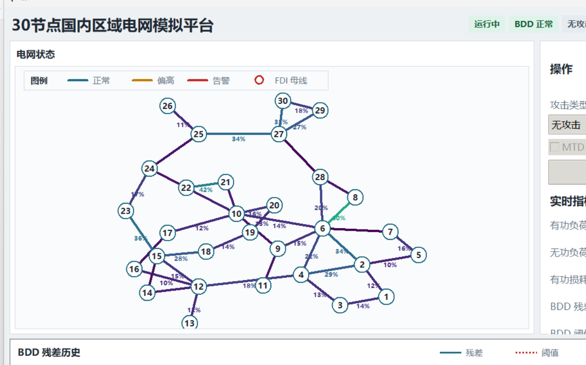

# 30 节点国内区域电网状态估计与安全防御可视化平台

> 基于开源项目 [Visual-Power-Grid](https://github.com/xuwkk/Visual-Power-Grid) 的二次开发



## 项目简介

本项目在开源项目 Visual-Power-Grid 的基础上进行二次开发，构建了一个面向国内区域电网的
**交流状态估计（AC-SE）与网络安全防御可视化平台**。平台底层基于 PyPower 求解最优潮流（OPF）
与状态估计，并通过 Tkinter + Matplotlib 实现实时可视化，直观展示：

- 电网稳态运行时的支路潮流（以线路有功限值的百分比表示）；
- 三种网络攻击模式下的量测对比与坏数据检测（BDD）残差；
- 移动目标防御（MTD）对 FDI 攻击的检测效果。

相对原项目的核心改进：将原 14 节点 IEEE 系统扩展为 **30 节点国内模拟电网**，并将全部界面汉化。

## 核心亮点

1. **全界面中文化（解决 matplotlib / tkinter 中文乱码）**
   所有 UI 文本、状态标签、图例均本地化为中文，并统一采用「微软雅黑」字体，
   彻底解决 Windows 下 matplotlib / tkinter 显示中文时的方块乱码问题。

2. **14 节点 → 30 节点国内模拟电网（自研 numpy 布局算法）**
   在环境无 networkx 依赖的前提下，基于 numpy 自行实现了 Fruchterman–Reingold
   力导向布局算法，生成 30 节点的分散美观布局，并结合画布自动缩放与居中，
   保证 30 节点不拥挤、不重叠。

3. **网络攻击模式可视化（无攻击 / 随机攻击 / FDI 攻击）**
   保留并完善原有三种攻击模式，在 30 节点下均可正常触发与检测：
   - **无攻击**：正常稳态运行；
   - **随机攻击**：随机篡改量测，BDD 残差显著升高并告警；
   - **FDI 攻击**：构造隐蔽性虚假数据注入，可绕过 BDD 检测。
   还可进一步开启 **MTD**（移动目标防御），主动改变线路电抗使攻击者的电网知识失效、残差升高。

## 主要功能

- 循环运行最优潮流（OPF），实时显示支路有功潮流（相对线路限值的百分比）；
- 稳态交流状态估计（AC-SE），输出卡方坏数据检测（BDD）残差；
- 三种攻击模式（无攻击 / 随机攻击 / FDI 攻击）及被攻击与正常量测的对比展示；
- 在 FDI 攻击下触发 MTD，主动改变线路电抗以破坏攻击者的电网知识；
- 展示历史 OPF 运行的残差曲线（正常 / 被攻击、是否开启 MTD）。

## 目录结构

```
.
├── visualization.py          # 主程序入口（Tkinter 界面）
├── class_se.py               # 交流状态估计（SE）与 BDD 检测
├── fdi_att.py                # FDI 攻击与 MTD 防御
├── power_sys.py              # 电力系统稳态仿真环境（OPF）
├── gen_data.py               # 案例生成与负荷数据生成
├── config_mea_idx.py         # 量测配置（RTU / FULL）
├── config_se.py              # 状态估计与 OPF 配置
├── requirements.txt          # 依赖清单
└── src/
    ├── case14/               # 原 IEEE 14 节点案例（坐标 + 负荷）
    └── case30/               # 30 节点国内模拟电网（坐标 + 负荷）
        └── coordinate.py     # 力导向布局生成的 30 节点坐标
```

## 环境依赖

| 依赖包 | 用途 |
| --- | --- |
| `numpy` | 矩阵 / 向量运算（量测、OPF、攻击） |
| `scipy` | 状态估计与卡方 BDD 检测阈值 |
| `pandas` | 读取 CSV 负荷数据 |
| `matplotlib` | Tkinter 内嵌的残差历史曲线图 |
| `pillow` | 加载界面 logo 图片 |
| `pypower` | IEEE 测试案例、OPF、潮流索引等 |
| `tkinter` | GUI（Python 自带，Linux 需另装 `python3-tk`） |

推荐 Python 3.10+（本项目开发环境为 Python 3.14，已在 3.10 与 3.14 下测试通过）。

## 如何运行

### 1. 克隆仓库

```bash
git clone https://github.com/deersoul0/Visual-Power-Grid.git
cd Visual-Power-Grid
```

### 2. 创建虚拟环境并安装依赖

```bash
# 创建并激活虚拟环境
python -m venv .venv
# Windows
.venv\Scripts\activate
# macOS / Linux
# source .venv/bin/activate

# 安装依赖
pip install -r requirements.txt
```

> 提示：Linux 用户若缺少 Tkinter，可先执行 `sudo apt install python3-tk`。

### 3. 启动可视化平台

```bash
python visualization.py
```

首次启动会自动生成 `src/case30/load/` 下的 30 节点合成负荷数据，无需手动下载。
若需运行原 14 节点案例，请从
[数据链接](https://drive.google.com/drive/folders/1EhFfxk6QZOYF3TU15mcWUXg65eC_s5_e?usp=sharing)
下载数据并将 `load_normalize_clean.csv` 复制到 `src/` 目录。

## 致谢

本项目为开源项目 [Visual-Power-Grid](https://github.com/xuwkk/Visual-Power-Grid)
的二次开发，衷心感谢原作者 **Wangkun Xu（[@xuwkk](https://github.com/xuwkk)）** 的开源工作。

底层电力系统计算（OPF / SE / BDD）封装自作者的另一开源仓库
[steady-state-power-system](https://github.com/xuwkk/steady-state-power-system)；
潮流与最优潮流求解基于 [PyPower](https://github.com/rwl/PYPOWER)
（[MATPOWER](http://www.pserc.cornell.edu/matpower/) 的 Python 移植）。

## 版权与引用

原始代码版权归原作者所有：Copyright (c) 2026 Wangkun Xu. All rights reserved.

如需学术引用，请引用原论文：

```bibtex
@article{xu2022robust,
  title={Robust moving target defence against false data injection attacks in power grids},
  author={Xu, Wangkun and Jaimoukha, Imad M and Teng, Fei},
  journal={IEEE Transactions on Information Forensics and Security},
  volume={18},
  pages={29--40},
  year={2022},
  publisher={IEEE}
}
```
